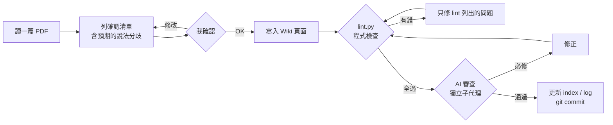
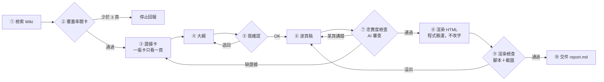

# 第十週作業：用 LLM Wiki 做一份教學 HTML 簡報

> 本作業與 Claude（Anthropic）協作完成。主題、資料、每次 ingest 與簡報大綱由我確認，頁面撰寫與檢查腳本由 Claude 依 AGENTS.md 產生。

## 1. LLM Wiki 主題與簡短介紹

**主題：AI 在運動科學的應用**

我原本想做「AI Agents 入門」，後來決定直接用自己下載的運動科學期刊（都是 Open Access），主題就跟著改成 AI 在運動科學的應用。這和我體育背景、之後的選才研究比較接得上。

先 ingest 5 篇完成作業要求、做出簡報後，我又照同樣的流程 ingest 第二批 4 篇（網球、板球、區塊鏈＋LLM、籃網球選才），共 9 篇。其中籃網球那篇不是 AI 研究，是選才制度的質性研究，我還是放進來當選才主題的背景，概念頁有註明。

Wiki 照 Karpathy 的 LLM Wiki 架構：`raw/` 放原始 PDF，`wiki/` 由 AI 維護，分成來源頁（9 頁）、概念頁（18 頁）、研究筆記頁（5 頁），`index.md` 是目錄，`log.md` 記錄每次 ingest。

建 Wiki 前先讓 AI 訪談我 9 個問題（讀者是誰、頁面類型、語言、出處要多細、資料矛盾怎麼辦、一次一篇還是批次、之後要產出什麼、lint 檢查什麼、Wiki 怎麼呈現），確認需求摘要後才產生 AGENTS.md。訪談紀錄在 [docs/需求訪談紀錄.md](需求訪談紀錄.md)。

我特別考量的幾件事：

- **讀者是之後要做研究的自己**，所以保留英文術語和原文定義，出處標到頁碼，之後寫論文可以直接回去查。
- **資料互相矛盾時不讓 AI 選邊**，兩邊並列並標「⚠ 說法分歧」。結果 9 篇裡找到 16 個分歧，例如「過去傷病是不是重要的預測因子」NBA 和英超的研究結論就不一樣。
- **一次 ingest 一篇**，每篇先看確認清單再寫入。比較慢，但每一步都看得到 AI 改了什麼。

## 2. LLM Wiki 連結

- Repo：https://github.com/Yenchen-H/ai-sport-wiki
- Wiki 目錄：https://github.com/Yenchen-H/ai-sport-wiki/blob/main/wiki/index.md

## 3. 教學 HTML 簡報連結

- https://yenchen-h.github.io/ai-sport-wiki/slides/ai-in-sport/
- 題目：AI 在運動科學能做什麼？（14 張，給不熟悉這個主題的人）
- 每張投影片頁尾都標出它用到的 Wiki 頁，重點後面保留原始論文出處。

## 4. Loop／Graph 設計

我做了兩條流程：建 Wiki 用 **loop**，做簡報用 **graph**。

### 4-1 Ingest loop（每篇資料跑一次）

| Loop 五件事 | 內容 |
|---|---|
| 目標 | 把一篇 PDF 整合進 Wiki，概念頁跨篇更新 |
| 限制 | 只能寫來源有的內容；不改 raw/；推論只能寫在研究筆記頁 |
| 完成標準 | lint.py 全過＋AI 審查沒有必修問題 |
| 停止條件 | 同一個問題最多改 3 輪 |
| 觸發 | 我說「ingest 下一篇」 |

**兩種檢查：**

- **程式檢查 `scripts/lint.py`**：出處格式、頁碼有沒有超過 PDF 頁數、英文引文是否逐字出現在那一頁 PDF、內部連結、孤兒頁、index 完整、「⚠ 說法分歧」段落至少要有 2 個不同出處、來源 ≥ 5 篇。
- **AI 審查**：開一個獨立的子代理，看不到我和 AI 的對話，只拿到 Wiki 頁面和 PDF，只寫報告、不能改檔。

### 4-2 簡報 graph

| 節點 | 只能看 | 不能做 |
|---|---|---|
| ③ 證據卡 | 一個 Wiki 頁 | 改寫；卡上的句子要逐字出現在 Wiki（腳本檢查） |
| ⑥ 逐頁稿 | 大綱＋該頁對應的卡 | 引用卡片以外的出處（腳本檢查） |
| ⑦ 忠實度檢查 | 逐頁稿＋對應 Wiki 頁 | 動手改 |
| ⑧ 渲染 | 已通過的逐頁稿 | 改任何一個字（用程式搬運） |

**哪些步驟會重複？** Ingest loop 每篇跑一次，共 5 次；簡報 graph 裡，⑥↔⑦ 是小圈，最多 2 輪。

**哪些地方要檢查或重新生成？** 錯在哪一關就退回哪一關：某頁講錯只重寫那頁，其他頁不動；證據不夠就退回 ③ 補卡；字太多就退回 ⑥ 縮短，不在 ⑧ 硬塞。

**為什麼這樣設計？** 建 Wiki 的每一篇工作都一樣、標準也一樣，所以用 loop。做簡報的各階段標準不同（證據卡要逐字、逐頁稿要白話、渲染不能改字），一份從頭重來太浪費，所以拆成 graph，讓錯誤在離源頭最近的地方被修掉。

## 5. 實際執行結果與檢查紀錄

完整紀錄：[wiki/log.md](../wiki/log.md)、[docs/review/](review/)（9 份 ingest 審查報告）、[slides/ai-in-sport/report.md](../slides/ai-in-sport/report.md)（簡報 graph 交件報告）。

| Ingest | lint.py | AI 審查（必修／建議） | 主要問題 |
|---|---|---|---|
| #1 Zhou 2025 綜述 | 第 1 輪全過 | 0 ／ 6 | "many studies" 寫成「多數研究」、"may" 寫成肯定 |
| #2 Cohan 2021 NBA | 第 1 輪全過 | 2 ／ 5 | 同一篇論文前後矛盾沒標分歧；推論標成出處 |
| #3 Majumdar 2024 英超 | 2 輪 | 3 ／ 15 | 引文截斷讓意思改變；分歧呈現偏袒一方 |
| #4 Rahimian 2025 xG＋LLM | 第 1 輪全過 | 2 ／ 3 | 把不矛盾的說法標成分歧（過度標記） |
| #5 Rothe 2026 戰術偵測 | 第 1 輪全過 | 3 ／ 3 | 問句被寫成結論 |
| **第二批** | | | |
| #6 Buhamra 2025 網球 | 第 1 輪全過 | 1 ／ 2 | 推論（勝負平衡）標成出處 |
| #7 Goel 2021 板球 | 修正後 1 錯 | 3 ／ 3 | 數字歸屬錯（訓練分數當成測試準確率） |
| #8 Ferreira 2026 區塊鏈＋MCP | 第 1 輪全過 | 0 ／ 3 | 沒有必修 |
| #9 Rongen 2026 籃網球選才 | 修正後 1 錯 | 1 ／ 3 | 推論句寫在概念頁 |

第二批改用「精簡模式」：只修必修，建議只記錄。

簡報 graph：⑦ 忠實度檢查第 1 輪退回 4／14 頁，其中 2 頁因為證據卡缺內容退回 ③ 補卡，第 2 輪全過；⑨ 渲染檢查 14 張都沒有溢出。

## 6. 反思

### 哪一個節點最常出錯？

**「把資料寫成 Wiki 頁面」這一步**，也就是 ingest 的撰寫節點。5 篇都有問題，而且幾乎都是 lint 抓不到、只有 AI 審查抓得到的：

- 最常見的是**語氣**：原文說 may、many、appear to，被寫成肯定句。從第 1 篇到第 5 篇都有，一直沒有完全消失。
- 第二批 4 篇換成另一種錯：**歸屬**。把推論標成來源出處、把作者引用的他人文獻寫成本研究的發現、把訓練分數當成測試準確率（因為照抄摘要，沒有對照表格）。
- lint 的逐字比對只能確認引文「存在」，抓不到「截斷後意思變了」，因為截斷後的片段仍然逐字存在於原文。

簡報這邊也一樣，⑦ 退回的 4 頁有 3 頁是「把可能寫成肯定」或「把範圍講大」。

### 發現問題後，檢查往前移到了哪一步？

1. **說法分歧從「寫完再審」往前移到「確認清單」**：第 2 篇審查發現分歧沒標，所以從第 3 篇開始，確認清單先列出預期的分歧給我看。結果分歧不再漏掉。
2. **簡報的證據卡改成「腳本逐字摘錄」**，在 ③ 就擋掉改寫造成的錯誤，⑥ 再用腳本限制只能引用卡片上的出處。這讓 ⑦ 退回時可以很清楚知道是「卡片缺內容」還是「逐頁稿寫錯」。

不過前移也有副作用。檢查往前移之後，錯誤**換了地方**：第 3 篇變成分歧「寫法」出錯，第 4 篇變成把不矛盾的東西也標成分歧。到第 5 篇，我在寫入前先對照表格，才擋下一個原本預告的假分歧。

第二批開始，確認清單除了列分歧，也先決定「哪些只寫成比較、不標 ⚠」。結果 4 篇的分歧判斷審查者都同意，過度標記沒有再發生，第 8 篇也第一次出現必修 0 個。

### 有沒有因此修改 workflow／graph？

有，改了 5 次：

1. **AGENTS.md 規則**：原本假設分歧只會發生在不同論文之間，第 2 篇遇到同一篇論文前後矛盾，就補上「同一來源內部也要標」，lint 也跟著改。
2. **lint.py 修了 3 個自己的 bug**：分歧檢查誤套到 log.md、跨頁範圍多讀一頁、簡報檢查漏算封面。檢查腳本本身也需要被檢查。
3. **改成精簡模式**：第 3 篇審查出 18 個問題，已經超過作業需要，從第 4 篇起只修必修、建議只記錄。完整嚴格度和花費的時間要取捨。
4. **簡報 graph 實際走過一次退回路線**：⑦ → ③ 補卡 → ⑥ 只重寫那幾頁，其他頁不動。
5. **第二批後 AGENTS.md 加了 2 條寫作規則**：「數字以表格為準」和「分清楚誰說的」，把第二批反覆出現的錯直接寫成規則，讓下次 ingest 一開始就照著做。

另外也發現 **AI 審查本身會出錯**，例如審查者誤報「zhou2025 沒有來源頁」，但其實有。所以 AI 審查的結果我還是會看過才決定要不要修。

第 9 篇還有一個有趣的情況：AI 審查建議把一句判斷「改成推論」，照做之後反而被 lint 擋下，因為規則規定概念頁每句都要有出處、推論只能寫在研究筆記頁。程式檢查和 AI 審查會互相抓對方的漏洞。

最後也要記錄一個我自己的流程失誤：第 7 篇修正後 lint 還有 1 個錯，但當時的指令沒有在 lint 失敗時停下來，就先 commit 了。之後改成 lint 全過才 commit。

### 其他心得

上週是一句話就讓 AI 建好 AGENTS.md，這週先訪談再生成，差別很明顯：規則都對應到我自己回答過的問題，後來要改規則時，也知道是改哪一題的決定。

講義那句「說『檢查一下』不算驗證」，這次體會很深。lint 第一次就全過的那幾篇，AI 審查還是抓出問題。完成的定義要寫成能執行的檢查，而且最好不只一種。
